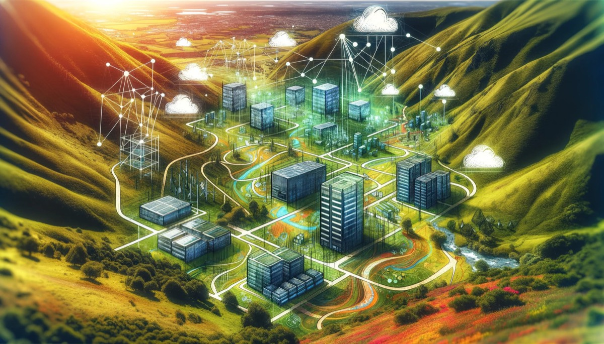
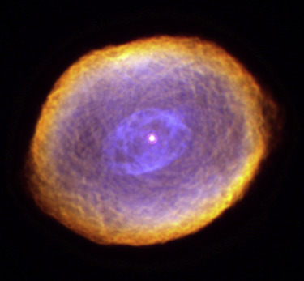

We are pleased to announce the launch of the Research Cockpit, a new system designed to assist researchers in managing their research data. This platform will evolve gradually, with additional products and services being introduced over time to support the entire research data lifecycle.

<!-- truncate -->

_This post is an archived version of the Research Data Stewards Newsletter Vol. 1, originally sent in November 2024._

## Launch of the Research Cockpit

The Research Cockpit brings together the tools, templates and support that researchers need throughout the research data lifecycle. It is the central place to find help with data management plans, ethical applications, data sharing agreements and more.

[Go to the Research Cockpit](https://cockpit.research.tue.nl/)

## Meet your data stewards

The data stewards support researchers in all faculties. At the time of this newsletter, the team consisted of:

| Data steward           | Faculty / role                                    |
| ---------------------- | ------------------------------------------------- |
| Liz Guzman-Ramirez     | Team lead                                         |
| Angela Aleksovska      | Electrical Engineering                            |
| Davide Nardi           | Mathematics and Computer Science                  |
| Jay Nair               | Industrial Engineering & Innovation Sciences      |
| Lucia Forrová          | Built Environment                                 |
| Neda Nozouri           | Biomedical Engineering, Mechanical Engineering    |
| Mariana Oshima Menegon | Industrial Design                                 |
| Nami Sunami            | Chemical Engineering & Chemistry, Applied Physics |

See the [contact page](/docs/contact) for the current team.

## What can we help you with?

- Funder requirements related to RDM
- Research data storage solutions
- Publishing data and software
- Ethics applications and informed consent forms
- Implementation of FAIR data
- Privacy questions
- Data management plans
- Legal agreements and impact assessments

[Read more about the data stewards](<https://tuenl.sharepoint.com/sites/intranet-LIS/SitePages/Data-stewards(1).aspx>)

## Trivia from data stewards: Planetary Nebula

Did you know that when our Sun starts to die, for a brief period of time (in astronomical time scales), it will become a planetary nebula? We think it will look something like this, with the outer layers reaching the orbit of the Earth.

_Liz (astrophysics)_

---

[Subscribe to the Research Data Stewards newsletter](https://par.copernica.tue.nl/)
