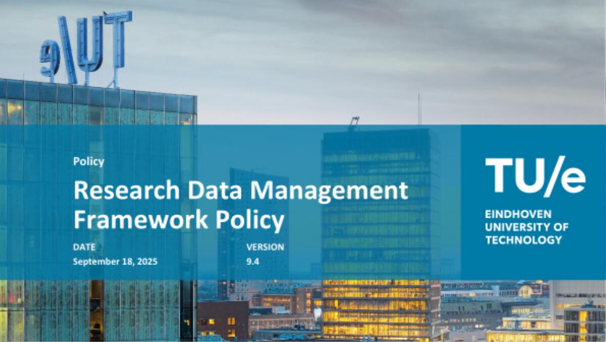

In this newsletter, we highlight the new TU/e Research Data Management Policy, the Research Cockpit, DataBites, the FAIR Data Clinic and the Open Science Community Eindhoven.

<!-- truncate -->

_This post is an archived version of the Research Data Stewards Newsletter Vol. 2, originally sent in July 2026._

## RDM Policy

Did you know that TU/e has a brand new Research Data Management Policy?

The TU/e Research Data Management Framework Policy defines roles and responsibilities for researchers and research support staff regarding the management of research data.

You can learn more about the policy and what it means to you on the [RDM Handbook page](/docs/intro/tue-policy/).

[Learn more about the RDM Policy](/docs/intro/tue-policy/)

## What's new in the Research Cockpit?

As part of being compliant with the RDM Policy, we have developed the Research Cockpit, a one-stop shop for researchers where you can find templates for your data management plan, ethical application, data sharing agreements and much more.

In this newsletter, we would like to highlight one of its services:

### RAPS: Research Archival Packaging Solution

RAPS is a closed TU/e archive for the data underlying your article once it is accepted for publication in a scientific peer-reviewed journal. RAPS preserves this research data for the long term.

[Go to RAPS](https://cockpit.research.tue.nl/servicedesk/customer/portal/7)

## DataBites

DataBites is a series of online sessions designed to spread awareness on various topics related to research data management. Each session features a quick 15-minute talk or demo, followed by a 15-minute chat, focusing on one specific RDM topic. From RDM essentials, FAIR principles, documentation, versioning and storage to preparing data for publishing (to name just a few).

[Join DataBites](/docs/learning-resources/data-bites/)

## FAIR Data Clinic

Do you care about your data having an impact beyond your papers?

Join our monthly FAIR Data Clinic: a practical session in which we help you make your dataset ready for repository deposit.

[Sign up for the FAIR Data Clinic](/docs/learning-resources/fair-clinic/)

## Open Science Community Eindhoven

The community is a growing group of researchers, engineers, scientists and university faculty who care about transparency and quality in science.

Our goal is to form an inclusive community of people working on improving the way we conduct open science at Eindhoven University of Technology, and to help others do the same.

[Learn more about OSC Eindhoven](https://osceindhoven.nl/)

## Trivia from data stewards: The Mere-Exposure Effect

_Andy Warhol's Campbell's Soup Cans paintings displayed at the Museum of Modern Art. Photographed by Brandon Fick, 12 May 2006. Source: Flickr. Licensed under CC BY 2.0._

Did you know that simply seeing something repeatedly makes you like it more, even if you do not realize it? Psychologists call this phenomenon the "mere-exposure effect". This is one reason why advertisers repeat their messages.

The effect highlights the power of the environment on us. Feeling a bit helpless? We can curate what we surround ourselves with to influence our preferences. Do you have something that you do not enjoy but want to do for the greater good? Perhaps you find making data FAIR challenging, but you want to do so for open science? You can surround yourself with things that you would like to overcome and let familiarity do its work. Keep the [RDM Handbook](https://rdm.tue.nl/) on your desk, join a [DataBites session](/docs/learning-resources/data-bites/), or sign up for a [FAIR Data Clinic](/docs/learning-resources/fair-clinic/). Let's design our environment to conquer our own resistance.

_Nami (social psychology)_

---

[Subscribe to the Research Data Stewards newsletter](https://par.copernica.tue.nl/)
